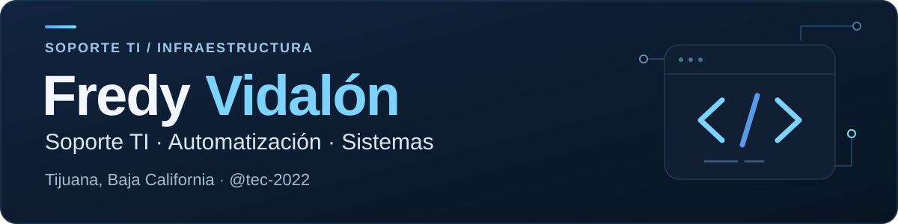
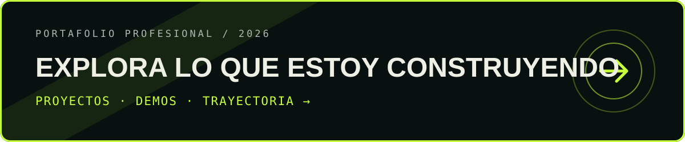
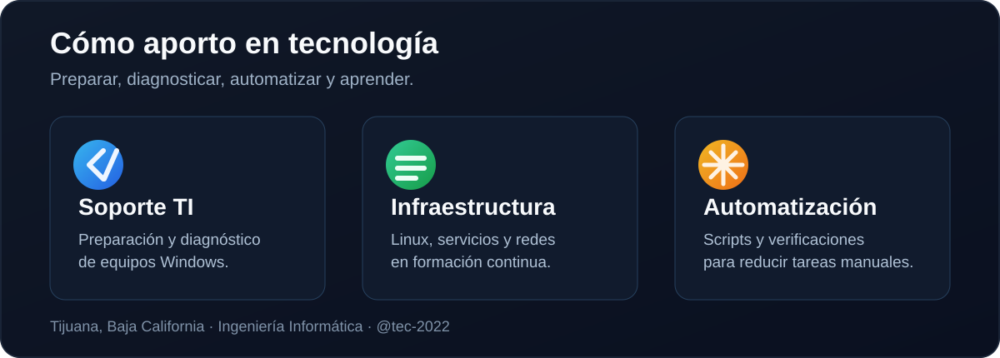

  

  

  <strong>Soporte técnico · Automatización · Sistemas y redes</strong>

  <a href="https://www.linkedin.com/in/fredylvl/">LinkedIn</a> ·
  <a href="https://tec-2022.github.io/">Portafolio bilingüe</a> ·
  <a href="https://orcid.org/0009-0006-4569-6920">ORCID</a>

## Hola, soy Fredy 👋

Soy **Fredy Luis Vidalón Lozano**, estudiante de **Ingeniería Informática** en Tijuana, México. Mi objetivo profesional es desarrollarme en **soporte TI, operación de sistemas e infraestructura**, apoyándome en la automatización y el desarrollo de herramientas útiles.

Me interesa diagnosticar problemas, preparar equipos, documentar soluciones y reducir tareas repetitivas. Aquí comparto proyectos de práctica y código abierto; **no los presento como experiencia laboral en producción**.

## Proyectos que respaldan mi perfil

| Proyecto | Evidencia técnica | Enlace |
| --- | --- | --- |
| **Academic Automation Kit** | Diagnóstico y preparación de equipos Windows, validación de software con Winget, comprobaciones de instalación, Python y PowerShell. | [Código y guía](https://github.com/tec-2022/-academic-automation-kit) |
| **LVL Mail** | Proyecto de backend e infraestructura de correo con endpoints de salud, seguimiento de mensajes, control de accesos y pruebas de seguridad documentadas. | [Arquitectura y código](https://github.com/tec-2022/LVL-Mail) |
| **Academic Professional Portal** | Aplicación web con verificaciones automatizadas, pruebas de navegador, accesibilidad, CI y documentación técnica. | [Código](https://github.com/tec-2022/uabc-professional-portal) · [Demo](https://prueba-pi-eight.vercel.app) |
| **GitHub Profile Booster** | Herramienta de código abierto para evaluar evidencia pública en perfiles y presentar resultados reproducibles. | [Código](https://github.com/tec-2022/github-profile-booster) · [Demo](https://tec-2022.github.io/github-profile-booster/) |

## Herramientas y áreas de práctica

- **Soporte de equipos:** Windows, preparación de entornos, instalación y verificación de aplicaciones, diagnóstico y documentación de incidencias.
- **Automatización:** Python, PowerShell y herramientas de línea de comandos para comprobaciones y tareas repetitivas.
- **Sistemas y servicios:** uso de Linux y terminal, fundamentos de conectividad, Git, Docker y conceptos de despliegue y monitoreo.
- **Desarrollo que complementa el soporte:** JavaScript/TypeScript, SQL, APIs y aplicaciones web.

> **En formación continua:** redes TCP/IP, DNS, DHCP, SSH, administración de Linux y resolución estructurada de incidentes. Estos son campos de aprendizaje, no certificaciones ni experiencia profesional que todavía no he acreditado.

  

## Objetivo profesional

Busco oportunidades **junior / nivel inicial** en soporte técnico, mesa de ayuda (Help Desk), operaciones TI o infraestructura, en Tijuana o en modalidad remota compatible con mi ubicación y autorización laboral.

**English:** Informatics Engineering student based in Tijuana, Mexico, interested in entry-level IT support, systems operations and infrastructure. I build practical tools for Windows diagnostics, software setup, automation and technical documentation. [Projects and portfolio](https://tec-2022.github.io/).

## Contacto

- [LinkedIn — Fredy Luis Vidalón Lozano](https://www.linkedin.com/in/fredylvl/)
- [Portafolio — español e inglés](https://tec-2022.github.io/)
- [Repositorios públicos](https://github.com/tec-2022?tab=repositories)

---

Si alguno de mis proyectos educativos o de código abierto te resulta útil, puedes [apoyar su mantenimiento en GitHub Sponsors](https://github.com/sponsors/tec-2022).

📌 [Actualización pública de septiembre de 2026](updates/2026-09.md) · [Calendario editorial](CONTENT_CALENDAR.md)

  <strong>Tijuana, Baja California · Lvltech Mx</strong> 
  Aprender, documentar, resolver y mejorar.

